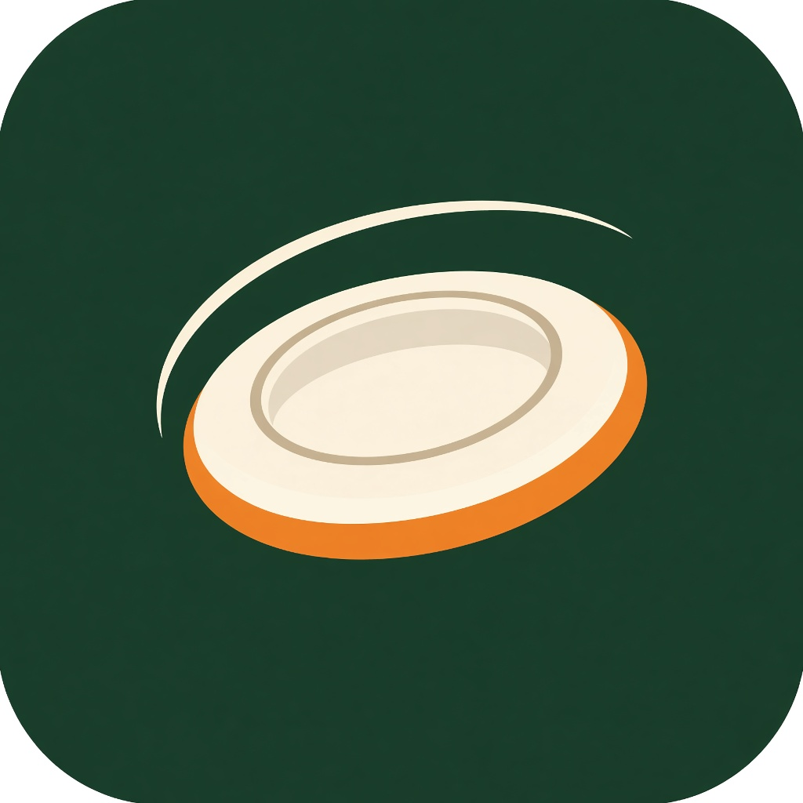

# Тарелочка

Явка и оплата тренировок клуба «Алтимат. Челябинск».

<p align="center">
  
</p>

Игроки остаются в общем чате Telegram. Бот спрашивает, запускать ли опрос, собирает ответы и после тренировки пишет, кому сколько перевести. Организатор ведёт людей, зал, расписание и оплату в веб-админке.

Сейчас в репозитории план и список задач. Кода приложения ещё нет.

## Документы

- [План](docs/design.md) — как система должна работать
- [Схема](docs/ARCHITECTURE.md) — рисунок для рассказа
- [Чат и таблица](docs/chat-and-sheet.md) — как клуб ведёт учёт сейчас
- [Задачи](docs/tasks/README.md) — порядок работы

## Разработка

Сначала всё на своей машине: Postgres в Docker, админка локально, отдельный тестовый бот в своём чате. Чат клуба и боевой сервер подключаются после прогона недели.

Частые команды собраны в `Makefile`. `make` печатает список.

```bash
make docker.start
make migrate
make run
make web
```

`make docker.start` поднимает контейнеры, Postgres среди них. Таблицы создаёт только `make migrate`: пары файлов `N_имя.up.sql` и `N_имя.down.sql` в `migrations/`. Инструмент — [golang-migrate](https://github.com/golang-migrate/migrate) v4.20.1.

## Стек

Один процесс Go отдаёт API, собранную админку, вебхук Telegram и планировщик. База — Postgres, деньги хранятся целыми рублями. Админка — React 19, TypeScript, Tailwind CSS, shadcn/ui, сборка Vite.
