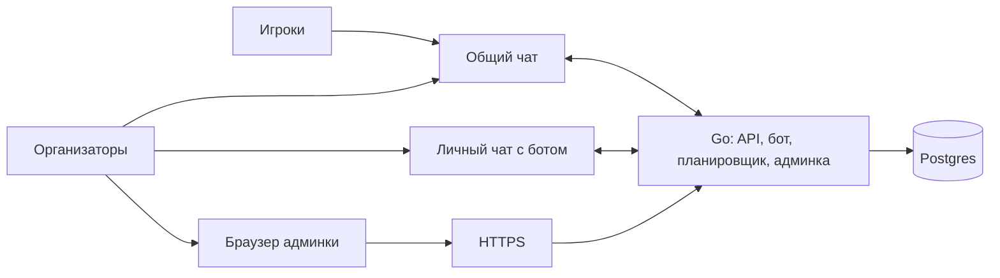
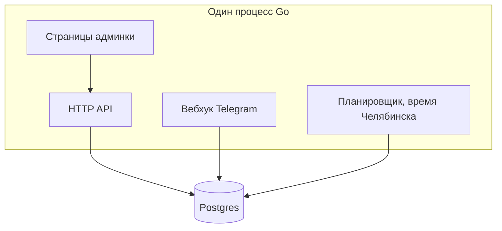
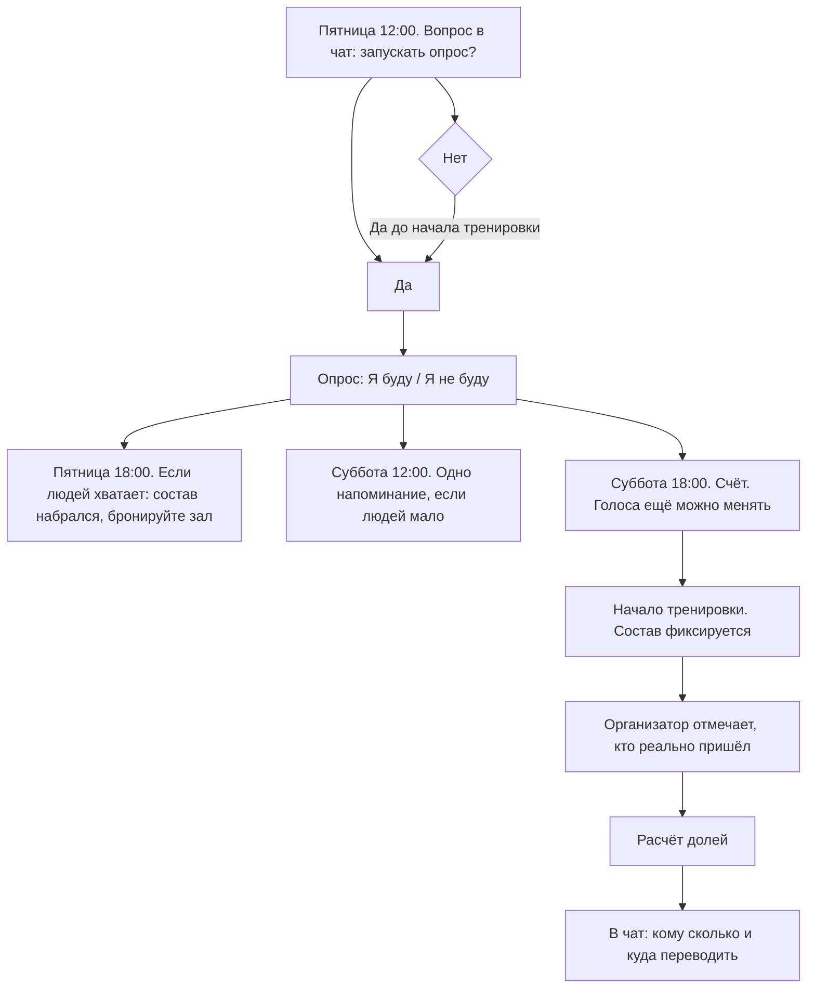
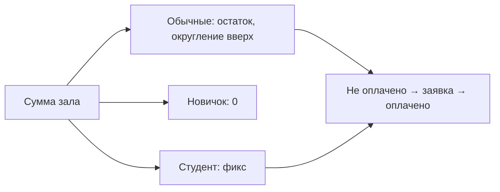
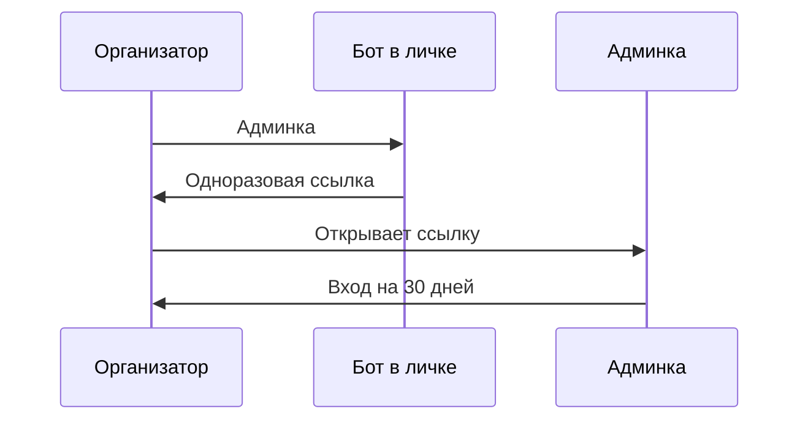

# Архитектура

Один клуб, один сервер, одна база. Игроки остаются в общем чате Telegram. Организаторы правят людей, зал, расписание и оплату в веб-админке.

Подробности поведения — в [design.md](design.md).

## Где что живёт

Админка — это React, собранный в тот же процесс Go. Отдельного фронтенд-сервера нет. Бот и сайт делят одну базу.

## Что делает процесс

Планировщик в пятницу спрашивает, запускать ли опрос, считает порог и по расписанию пишет общий долг. Вебхук принимает голоса и кнопку «Оплатил».

## Неделя

«Нет» до появления опроса ставит пропуск. Следующее «Да» этот пропуск снимает. Уже опубликованный опрос кнопка «Нет» не убирает.

## Деньги

Заявку в чате может нажать сам человек или тот, за кого он платит: Вика за пару с Денисом, Лена за пару с Димой. Оплаченной доля становится после подтверждения организатора в админке. Депозит Дениса закрывает целые доли сам, до сообщения в чат.

Раз в несколько дней, по умолчанию каждые 3 дня, бот пишет в чат один список: у кого какой долг и за какие тренировки. Интервал меняется в админке.

## Вход организатора

На компьютер, телефон и следующее устройство каждая ссылка своя. Пароля нет.
